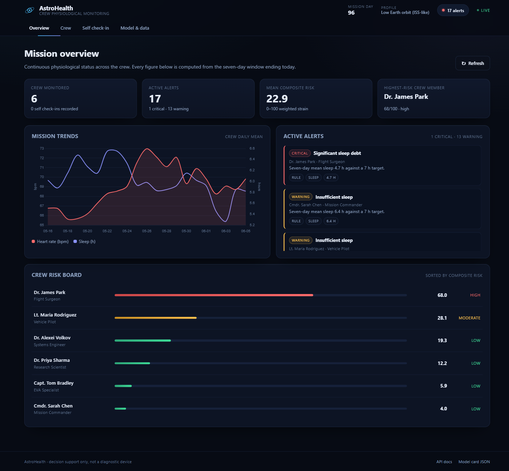
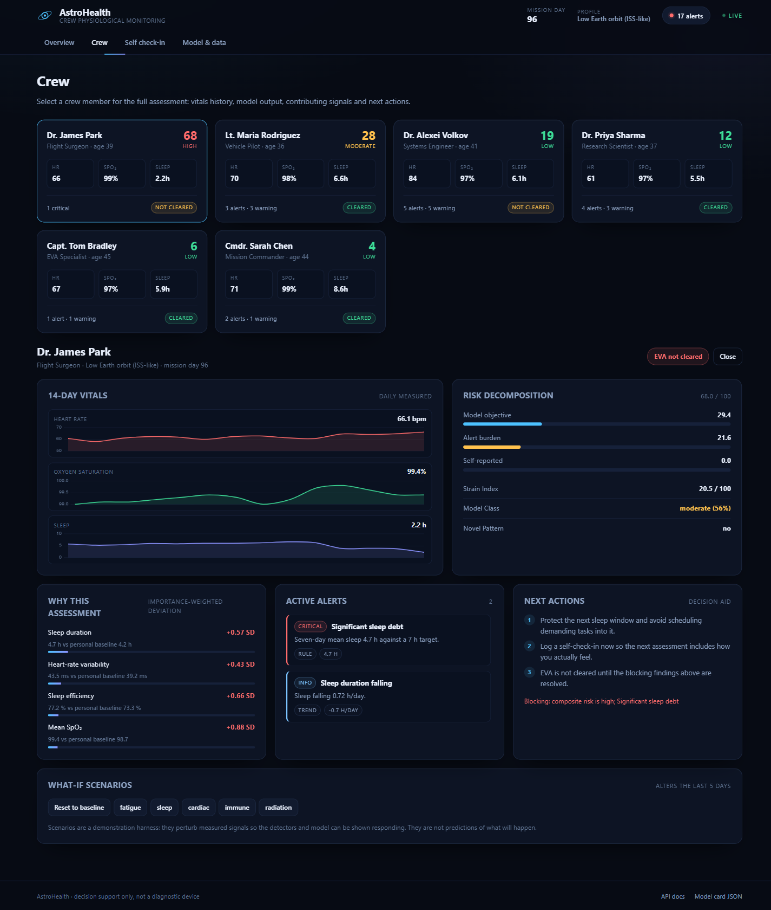
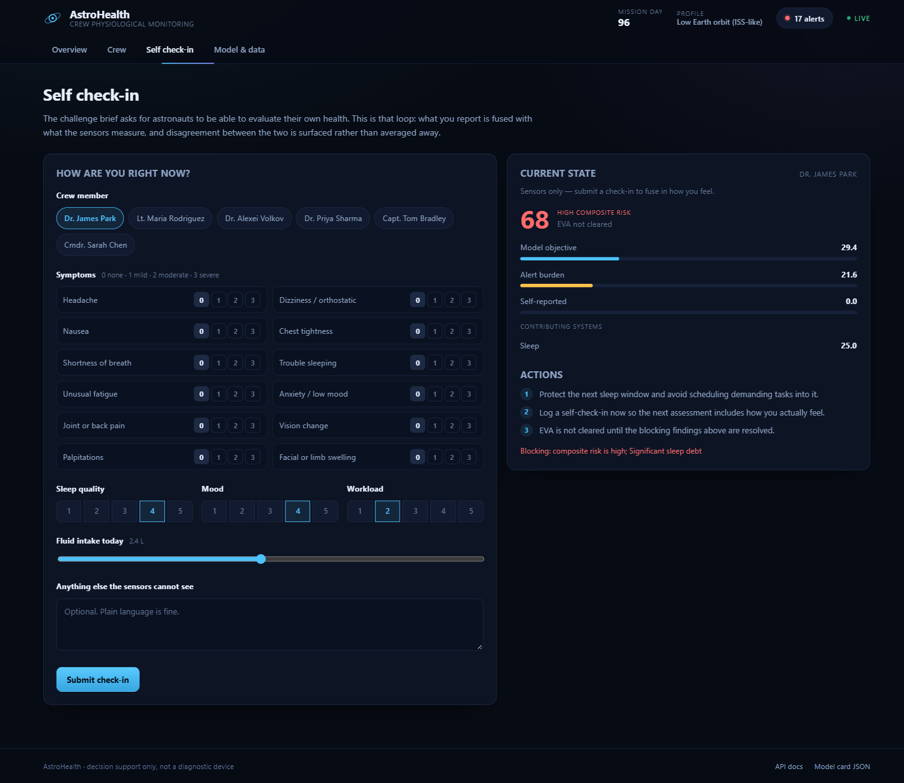
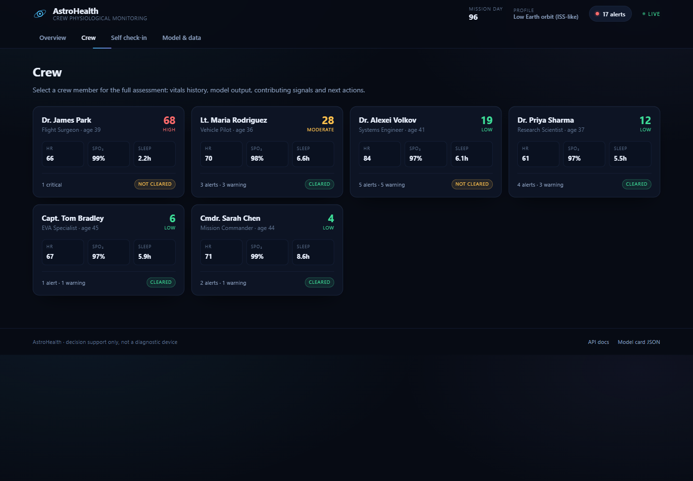
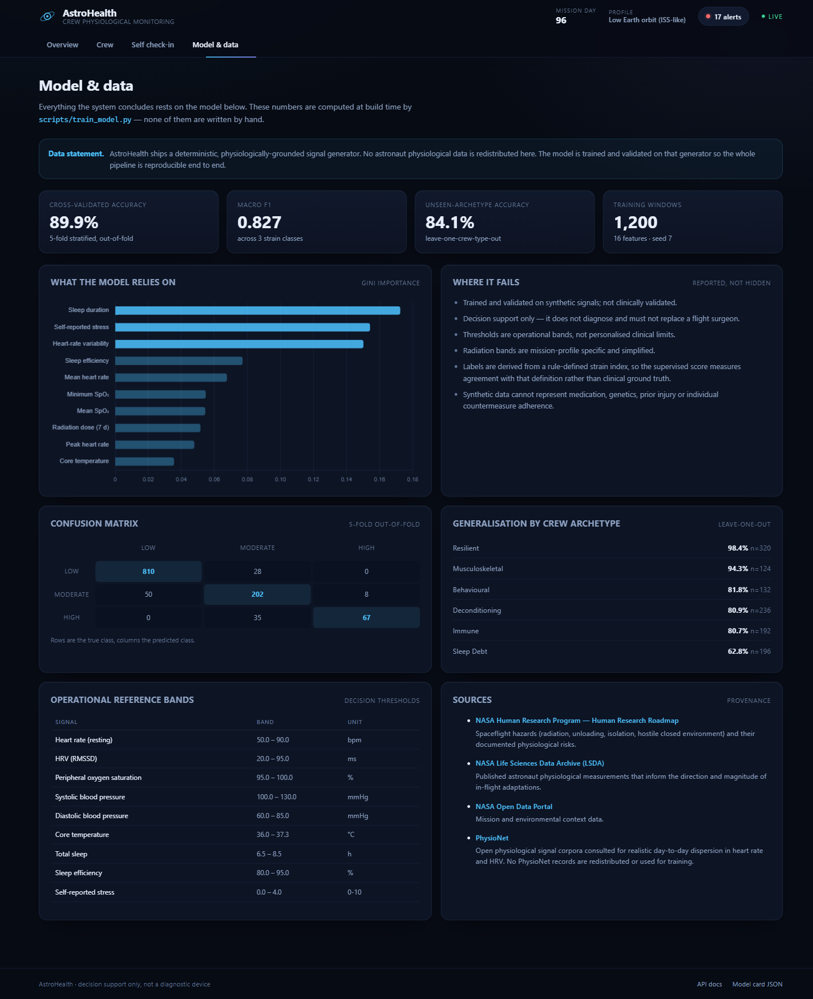

# AstroHealth

**Crew-facing health monitoring for long-duration spaceflight.** Sensor fusion, a validated strain model, and a self-assessment loop that surfaces disagreement between what the crew member reports and what the instruments measure.

[](https://nexussai-blush.vercel.app)
[](tests)
[](LICENSE)
[](requirements.txt)

**[Open the live application →](https://nexussai-blush.vercel.app)**



---

## The problem

On a long-duration mission there is no clinic to walk into. A crew member has to notice that something is wrong, decide how serious it is, and decide whether it is safe to leave the vehicle — often while fatigued, isolated, and months from help. Telemetry alone does not answer that: it tells you a heart rate, not whether the person inside it feels wrong.

AstroHealth closes that loop. It continuously fuses measured physiology with what the crew member says about themselves, and it treats a disagreement between the two as a finding rather than noise.

## What it does

| Capability | Implementation |
|---|---|
| Continuous status across the crew | Seven-day rolling windows over 16 physiological features, scored every refresh |
| Explainable strain classification | Random Forest over `low` / `moderate` / `high`, plus a continuous strain index |
| Unknown-pattern detection | Isolation Forest raises novelty when the window does not resemble anything in the training cohort |
| Rule, trend and baseline detection | Threshold breaches, week-over-week drift, and personal-baseline deviation |
| Self-assessment | Crew check-in with symptom severities, sleep, mood, workload and hydration, fused into the same score |
| Disagreement surfacing | Reports when crew reports materially worse than sensors, or vice versa |
| Decision support | Ranked contributing signals, concrete next actions, and EVA clearance gating |
| What-if harness | Perturb the last five days to watch detectors and the model respond |

### Screens

| Crew detail | Self check-in |
|---|---|
|  |  |

| Crew board | Model & data |
|---|---|
|  |  |

## Architecture

```
                      ┌──────────────────────────────────────────┐
  signal source ──────▶│ astrohealth.synthetic                    │
  (deterministic,      │  archetypes → per-day physiology         │
   physiologically     │  episodes → deliberate deterioration     │
   grounded)           └───────────────┬──────────────────────────┘
                                       │ 7-day windows
                        ┌──────────────▼──────────────┐
                        │ astrohealth.features         │  16 features,
                        │ window_features()            │  identical at train
                        └──────┬───────────────┬───────┘  and serve time
                               │               │
                    ┌──────────▼──────┐  ┌─────▼─────────────┐
                    │ StrainModel     │  │ detectors         │
                    │ RandomForest    │  │ rule / trend /    │
                    │ IsolationForest │  │ baseline / novelty│
                    └──────────┬──────┘  └─────┬─────────────┘
                               │               │
                        ┌──────▼───────────────▼──────┐
                        │ astrohealth.risk            │
                        │ objective + burden +        │
                        │ subjective → composite,     │
                        │ readiness, actions          │
                        └──────────────┬──────────────┘
                                       │ JSON
                        ┌──────────────▼──────────────┐
                        │ FastAPI (app.py)            │
                        │ /api/*  +  static SPA       │
                        └─────────────────────────────┘
```

The frontend is a single-page application with no build step: one HTML shell, one stylesheet, one script, and Chart.js from a CDN. Every view is a pure render of the last successful API response, so a failed request can never leave stale numbers on screen.

## The model

A `RandomForestClassifier` predicts a three-class strain level; a continuous **strain index** is computed from a weighted deviation score so the UI can show how far into a band a crew member is. Labels are derived from that index with cuts at 18.0 and 28.0, tuned to keep the classes from collapsing.

Violin-free details:

- **1,200 training windows**, 16 features, `seed=7`
- Class balance: `low` 838 · `moderate` 260 · `high` 102
- Validated twice: stratified 5-fold on held-out folds, **and** leave-one-archetype-out, which removes an entire crew type from training to test generalisation to people unlike anyone seen

### Measured performance

| Evaluation | Accuracy | Macro F1 |
|---|---|---|
| Stratified 5-fold (out-of-fold) | **89.9%** | **0.827** |
| Leave-one-archetype-out | **84.1%** | **0.687** |

Per class, 5-fold:

| Class | Precision | Recall | Support |
|---|---|---|---|
| low | 0.942 | 0.967 | 838 |
| moderate | 0.762 | 0.777 | 260 |
| high | 0.893 | 0.657 | 102 |

Confusion matrix (rows true, columns predicted):

|  | low | moderate | high |
|---|---:|---:|---:|
| **low** | 810 | 28 | 0 |
| **moderate** | 50 | 202 | 8 |
| **high** | 0 | 35 | 67 |

Generalisation by crew archetype when that archetype was never seen in training:

| Archetype | Accuracy | n |
|---|---:|---:|
| Resilient | 98.4% | 320 |
| Musculoskeletal | 94.3% | 124 |
| Behavioural | 81.8% | 132 |
| Deconditioning | 80.9% | 236 |
| Immune | 80.7% | 192 |
| Sleep debt | 62.8% | 196 |

Sleep debt is the weak point, and the application says so on the model page rather than hiding it. Moderate and high strain are separated mostly by sleep architecture and self-reported stress, so a short-sleep pattern that has not yet produced autonomic change is genuinely ambiguous.

Top features by Gini importance: sleep duration (0.172), self-reported stress (0.154), HRV RMSSD (0.150), sleep efficiency (0.077), mean heart rate (0.068), minimum SpO₂ (0.055).

All numbers above are read from `models/metrics.json`, which `scripts/train_model.py` writes at build time. Nothing in the interface is hand-typed.

## Data statement

This repository ships **no astronaut physiological data**. The signal generator in `astrohealth/synthetic.py` is deterministic and physiologically grounded: resting and recovery values, circadian structure, and the direction and rough magnitude of in-flight adaptations are drawn from published human-spaceflight literature, then perturbed around six crew archetypes. Episodes apply a documented set of per-day deltas so the detectors have a real deterioration to find.

That choice is deliberate. A demo that invents plausible patient data and calls it real is worse than one that says what it is.

Operational reference bands and the provenance for each are exposed live at `/api/reference` and rendered on the model page. See **[docs/DATA_AND_LIMITATIONS.md](docs/DATA_AND_LIMITATIONS.md)** for the full statement, and **[docs/MODEL_CARD.md](docs/MODEL_CARD.md)** for the model card.

## Quick start

```bash
git clone https://github.com/abinivesh-m/NexussAI.git
cd NexussAI

python -m venv .venv
# Windows: .venv\Scripts\activate
# macOS/Linux: source .venv/bin/activate

pip install -r requirements.txt
python -m uvicorn app:app --host 127.0.0.1 --port 8000
```

Open <http://127.0.0.1:8000>. The model bundle is committed, so the first boot is fast; if it is missing, the app trains it once from the deterministic generator.

Retrain and rewrite the metrics file:

```bash
python scripts/train_model.py
```

## API

| Method | Path | Purpose |
|---|---|---|
| `GET` | `/api/health` | Liveness, model version, crew size |
| `GET` | `/api/model` | Model card: metrics, features, limitations, data statement |
| `GET` | `/api/reference` | Operational bands, symptom vocabulary, citations |
| `GET` | `/api/crew` | All crew, sorted by composite risk |
| `GET` | `/api/crew/{id}` | Full assessment: features, prediction, alerts, explanation, risk |
| `GET` | `/api/crew/{id}/series?days=14` | Daily measured series for charting |
| `POST` | `/api/crew/{id}/checkin` | Fuse a self-assessment into the score |
| `POST` | `/api/crew/{id}/simulate` | Apply or reset a what-if scenario |
| `GET` | `/api/alerts` | All active alerts, crew-wide, severity ordered |
| `GET` | `/api/trends?days=21` | Crew daily means |
| `POST` | `/api/reset` | Restore the deterministic cohort |

Interactive schema at `/docs`. Check-in payloads are validated: unknown symptoms and out-of-range severities are rejected with `422`, not silently ignored.

## Tests

```bash
pip install -r requirements-dev.txt
python -m pytest -q
```

**35 tests, all passing.** They run the real FastAPI application rather than a mock, and cover the HTTP contract, detector behaviour for each failure mode, feature-extraction invariants (train/serve parity, window boundaries), model monotonicity, and the honesty of the model card itself — including a test that fails if the limitations list is ever emptied.

## Deployment

- **Vercel** — `vercel.json` builds `api/index.py` as a Python function and rewrites all paths to it. Live instance: <https://nexussai-blush.vercel.app>
- **Docker** — `docker build -t astrohealth . && docker run -p 8000:8000 astrohealth`
- **Render** — `render.yaml` is included for a free web-service deploy

## Limitations

- Trained and validated on synthetic signals. **Not clinically validated.**
- Decision support only: it does not diagnose and must not replace a flight surgeon.
- Thresholds are operational bands, not personalised clinical limits.
- Labels are derived from a rule-defined strain index, so the supervised score measures agreement with that definition rather than clinical ground truth.
- Synthetic data cannot represent medication, genetics, prior injury, or countermeasure adherence.
- Radiation bands are mission-profile specific and simplified.

## License

MIT — see [LICENSE](LICENSE).
